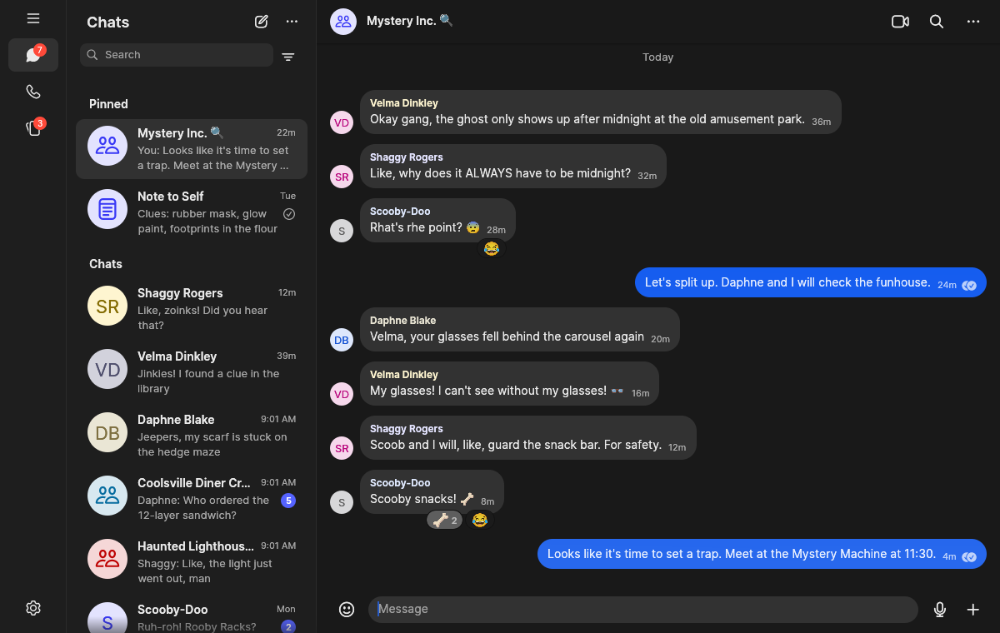

# langis-gui

Signal Desktop, 1:1, in native Rust. No Electron.

Same layout, colors, fonts, icons and menus as Signal Desktop, drawn with
[egui](https://github.com/emilk/egui) on top of
[langis](https://github.com/adelmonte/langis). It links to your phone as a
secondary device, just like Desktop: chats, groups, calls, stories,
reactions, polls, voice messages, stickers and the rest.

Calls minimize to a small window so you can keep chatting, and Desktop's
keyboard shortcuts work (Ctrl+/ lists them).

Unofficial, and not affiliated with Signal.



The picture is the demo account with made-up chats
(`cargo test readme_screenshot -- --ignored` renders it).

## Not there yet

Checked against Signal Desktop 8.38's source in November 2026. Items
marked (langis) need backend work first.

- Backups and Notification profiles (langis): each is its own project.
- No tray icon (egui has none), and no text or preset avatars in the
  profile editor.
- Per-chat "while muted" exceptions and unread reminders (langis; the
  account-wide ones work).
- Some notices only come from transferred history so far: joined Signal,
  merged chats, a number that belongs to someone, the name a chat started
  with. The default-timer notice in new chats and group V1 migration
  notices aren't made at all.
- Files from transferred history download without progress.
- Dropping files on the window may not work on Wayland (winit's support).
- Signal links from other apps aren't handed over (paste them into New
  chat).

Not yet tried on a real account: calls (the lobby, speaking indicators,
ringtone), sounds, paste and drag-and-drop, and chat export.

## Install

Needs [langis](https://github.com/adelmonte/langis) checked out next to it
(`../langis`) and its build tools: `protoc`, `clang`, `cmake`, PulseAudio
and PipeWire headers. At runtime, voice messages need `ffmpeg` (recording
and playback) and PipeWire's `pw-play` (playback). For color emoji, install
Noto Color Emoji.

```sh
./install.sh               # builds and installs for your user
./install.sh --uninstall   # removes it; your data stays
```

Or run it in place:

```sh
cargo run --release
cargo run --release -- --demo   # made-up chats, no account
```

Your data lives in `~/.local/share/langis-gui`, encrypted.

## License

AGPL-3.0-only. See LICENSE and NOTICE.
